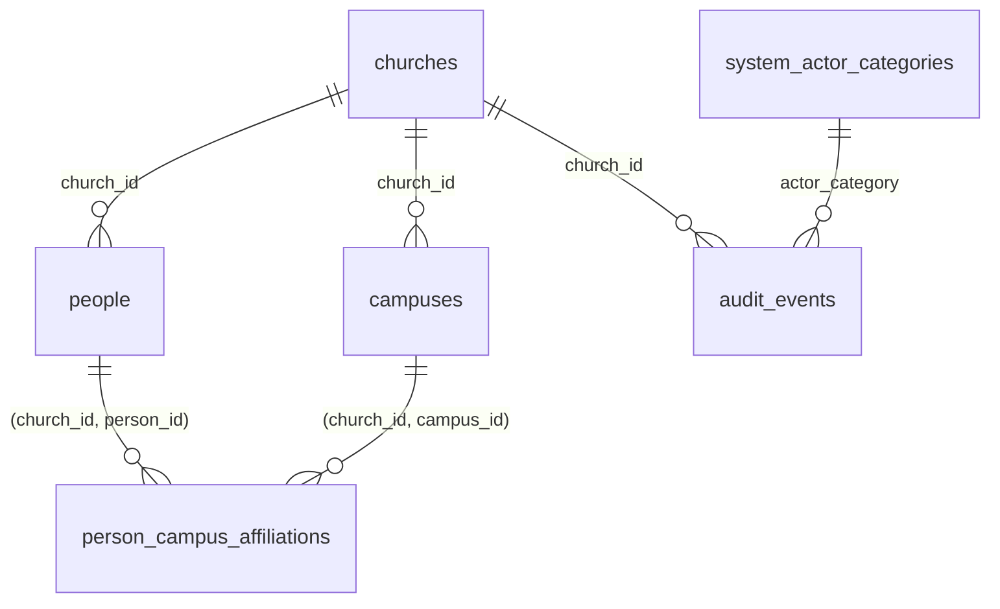

# CHMS-F001 — Database design proposal

**Status: ACCEPTED DESIGN — approved by the product owner, Patrush, on 2026-10-27 through ADR-001 to ADR-008, with amendments. No migration has been written or executed, and compatibility proofs CP-01 to CP-09 have not run yet.**

- Feature: [CHMS-F001 specification](../features/CHMS-F001/specification.md)
- Decisions: [CHMS-F001 decision register](../decisions/CHMS-F001-decision-register.md)
- Summary package: [DB-01](DB-01.md). This design details part of it; the DB-01 summary itself is unchanged.
- Target: PostgreSQL 18 (BR-10); ADR-001 to ADR-008 are Accepted.

SQL in this document is design notation, not migration code. Object and constraint names below are part of the design; constraint names matter because the service maps database errors to domain errors by constraint name.

## 1. Entities and relationships

| Table | Purpose | Rules |
|---|---|---|
| `chms.churches` | The single church of the installation | BR-01, BR-09 |
| `chms.campuses` | Campuses of the church | BR-01, BR-06, BR-07 |
| `chms.people` | People, independent of accounts | BR-02, BR-08 |
| `chms.person_campus_affiliations` | Links between people and campuses, with history | BR-03 to BR-06 |
| `chms.system_actor_categories` | Allowlist of system actor categories | POL-01, POL-02 |
| `chms.audit_events` | Append-only audit trail | POL-01 to POL-04 |

Out of this design (deferred MVP scope): households, relationships, membership and visitor status, contact details, date of birth, campus address and timezone, account links.

## 2. Tables, constraints and indexes

Shared conventions:
- `id uuid PRIMARY KEY DEFAULT uuidv7()` (ADR-001, amended to UUIDv7; `uuidv7()` is new in PostgreSQL 18).
- `row_version integer NOT NULL DEFAULT 1 CHECK (row_version >= 1)`.
- `created_at` and `updated_at` are `timestamptz NOT NULL DEFAULT now()`.
- Every foreign key is `ON UPDATE RESTRICT ON DELETE RESTRICT`.
- Name checks follow ADR-008 and the approved name rules (PPD-01; RR-16 is closed for F001). Every name column (church and campus `name`, person `display_name`, and `given_name` and `family_name` when present) is NFC, has no leading or trailing Unicode whitespace (a pattern check, because `btrim()` removes only spaces), contains no control characters (Unicode `Cc`), and is 1–100 characters after trimming. Internal whitespace and capitalization are kept as entered.

### `chms.churches`
| Column / constraint | Definition |
|---|---|
| `singleton` | `boolean NOT NULL DEFAULT true` |
| `churches_singleton_ck` | `CHECK (singleton)` |
| `churches_singleton_uq` | `UNIQUE (singleton)`, so at most one row can exist |
| `name` | `text NOT NULL`; `churches_name_ck`: approved name rules (trimmed, NFC, no control characters, 1–100 characters) |

### `chms.campuses`
| Column / constraint | Definition |
|---|---|
| `church_id` | `uuid NOT NULL`; `campuses_church_fk → churches(id)` |
| `name` | `text NOT NULL`, stored as entered so capitalization is preserved; `campuses_name_ck`: approved name rules (trimmed, NFC, no control characters, 1–100 characters) |
| `status`, `archived_at` | `status text NOT NULL DEFAULT 'active'`, constrained by `campuses_status_ck` to `'active'` or `'archived'`; `archived_at timestamptz NULL` |
| `campuses_archive_state_ck` | `CHECK ((status = 'archived') = (archived_at IS NOT NULL))` |
| `campuses_church_id_uq` | `UNIQUE (church_id, id)`: target of the existence foreign key |
| `campuses_church_id_status_uq` | `UNIQUE (church_id, id, status)`: target of the status-carrying foreign key |
| `campuses_name_ci_uq` | `UNIQUE INDEX (church_id, casefold(name))`, or `(church_id, lower(name))` if CP-08 shows `casefold()` unsuitable (ADR-008); covers archived rows (BR-07) |

### `chms.people`
| Column / constraint | Definition |
|---|---|
| `church_id` | `uuid NOT NULL`; `people_church_fk → churches(id)` |
| `display_name` | `text NOT NULL`; `people_display_name_ck`: approved name rules (BR-08); the authoritative name |
| `given_name`, `family_name` | `text NULL`; `people_given_name_ck` and `people_family_name_ck`: NULL, or the approved name rules (never an empty string); no synchronization rule with `display_name` |
| `status`, `archived_at` | As for campuses, with `people_status_ck` and `people_archive_state_ck` |
| `people_church_id_uq`, `people_church_id_status_uq` | `UNIQUE (church_id, id)` and `UNIQUE (church_id, id, status)` |
| Not present | Account references, contact details, date of birth, membership status (BR-02 and deferred scope) |

### `chms.person_campus_affiliations`
| Column / constraint | Definition |
|---|---|
| `church_id`, `person_id`, `campus_id` | `uuid NOT NULL` |
| `is_primary` | `boolean NOT NULL DEFAULT false`; kept on ended rows as history |
| `person_status`, `campus_status` | `text NULL DEFAULT 'active'`; `pca_person_status_ck` / `pca_campus_status_ck`: NULL or `'active'` |
| `ended_at`, `end_reason` | `timestamptz NULL`; `text NULL`, constrained by `pca_end_reason_ck` to `'ended'` or `'person_archived'` |
| `pca_lifecycle_ck` | Active (`ended_at`, `end_reason` NULL; both status columns `'active'`) **or** ended (`ended_at`, `end_reason` set; both status columns NULL) |
| `pca_person_fk` | `(church_id, person_id) → people(church_id, id)` |
| `pca_campus_fk` | `(church_id, campus_id) → campuses(church_id, id)` |
| `pca_person_active_fk` | `(church_id, person_id, person_status) → people(church_id, id, status)`, `MATCH SIMPLE` |
| `pca_campus_active_fk` | `(church_id, campus_id, campus_status) → campuses(church_id, id, status)`, `MATCH SIMPLE` |
| `pca_active_pair_uq` | `UNIQUE (person_id, campus_id) WHERE ended_at IS NULL` |
| `pca_active_primary_uq` | `UNIQUE (person_id) WHERE is_primary AND ended_at IS NULL` |
| `pca_person_ix`, `pca_campus_ix` | Plain indexes on `person_id` and `campus_id`, supporting the `RESTRICT` checks and scoped reads |

### `chms.system_actor_categories`
| Column / constraint | Definition |
|---|---|
| `category` | `text PRIMARY KEY`; `CHECK (category ~ '^[a-z][a-z0-9_-]{1,40}$')` |
| Contents | Production migrations insert `bootstrap` and `maintenance` (POL-01). Test categories are inserted only by test-environment setup, never by the migration chain (POL-02) |

### `chms.audit_events`
| Column / constraint | Definition |
|---|---|
| `church_id` | `uuid NOT NULL → churches(id)` |
| `xact_id` | `xid8 NOT NULL DEFAULT pg_current_xact_id()` |
| `occurred_at` | `timestamptz NOT NULL DEFAULT clock_timestamp()` |
| `actor_kind` | `text NOT NULL`; `audit_actor_kind_ck`: `= 'system'` (widened only by CHMS-F002) |
| `actor_category` | `text NOT NULL`; `audit_actor_category_fk → system_actor_categories(category)` |
| `actor_user_id` | `uuid NULL`; `audit_actor_user_ck`: `IS NULL` |
| `action` | `create`, `update`, `archive`, `unarchive`, `end_affiliation`; derived by the trigger |
| `entity_type`, `entity_id` | `church`, `campus`, `person` or `person_campus_affiliation`; `uuid` |
| `changed_fields` | `text[] NOT NULL DEFAULT '{}'`: column names only, never values |
| Indexes | `(entity_type, entity_id, occurred_at)`, `(xact_id)` |

## 3. Database-enforced invariants

| Invariant | Mechanism | Rule |
|---|---|---|
| At most one church | `churches_singleton_uq` | BR-01 |
| Identity columns never change | Column grants, `chms.forbid_identity_change()` (SQLSTATE `CHI01`), `ON UPDATE RESTRICT` | BR-09 |
| No cross-church references | Composite foreign keys on `(church_id, …)` | BR-01 |
| Campus names unique (case-insensitive, archived included) | `campuses_name_ci_uq` | BR-07 |
| No active affiliation to an archived campus or person | `pca_campus_active_fk`, `pca_person_active_fk` | BR-04, BR-06 |
| At most one active link per person–campus pair, and one active primary | Partial unique indexes | BR-03 |
| Ended affiliations immutable; no deletion | `chms.forbid_history_change()` (SQLSTATE `CHH01`); no `DELETE` grant | BR-04 |
| Display name present and non-blank | `people_display_name_ck` | BR-08 |
| Every change audited with a declared system actor | Audit triggers (SQLSTATE `CHA01` when no actor is declared) | POL-01, POL-02 |
| Audit append-only | Audit triggers (SQLSTATE `CHA02`) | POL-04 |

## 4. Transaction behavior

Service transactions run at READ COMMITTED. Each one declares an actor with `set_config('chms.actor_category', …, true)`, and every `UPDATE` checks `row_version`. Errors are mapped outside the transaction callback; code inside a transaction must never catch a database error and continue. This rule also avoids the trigger condition of the reported, unverified [drizzle-orm #6572](https://github.com/drizzle-team/drizzle-orm/issues/6572) (CP-05, TS-F001-33).

| Operation | Statements | Expected failure → domain error |
|---|---|---|
| Bootstrap (owner role) | Insert the church if none exists; otherwise compare names | `23505` on `churches_singleton_uq` → `ChurchAlreadyExists`; name differs → `ChurchMismatch` |
| Create or rename campus | `INSERT` / `UPDATE … WHERE row_version = $v` | `23505` on `campuses_name_ci_uq` → `CampusNameTaken` |
| Archive campus | `UPDATE campuses SET status = 'archived', archived_at = now() …` | `23001` on `pca_campus_active_fk` → `CampusHasActiveAffiliations` [E1] |
| Link a person to a campus | `INSERT` | `23503` on `pca_campus_active_fk` / `pca_person_active_fk` → `CampusArchived` / `PersonArchived`; `23505` on the partial indexes → `AffiliationExists` / `PrimaryAffiliationExists` |
| Archive person | (1) end active affiliations; (2) archive the person | `23001` on `pca_person_active_fk` in step 2 [E1] → roll back and retry once, then `ConcurrentAffiliationChange` |
| Unarchive person or campus | `UPDATE` status only; affiliations are not restored | — |
| Any update | Zero rows affected | `ConcurrentModification` |
| Any transaction | `40001` or `40P01` | Retry up to 3 times |

**Concurrency analysis (theoretical, from the [PostgreSQL row-lock documentation](https://www.postgresql.org/docs/current/explicit-locking.html), checked 2026-10-27; nothing executed):**
- Changing `status` modifies a column of `…_church_id_status_uq`, which is a unique index usable by a foreign key, so the `UPDATE` takes `FOR UPDATE`.
- That lock conflicts with the `FOR KEY SHARE` lock taken by the foreign-key check of a concurrent affiliation insert, so the two transactions serialize.
- At READ COMMITTED a blocked insert fails with `23503` and a blocked archive with `23001`; at REPEATABLE READ the insert fails with `40001` and the archive with `23001` [E1, observed in CP-06].
- Updates that change only names take `FOR NO KEY UPDATE` and do not conflict with foreign-key checks.

Proof tests: TS-F001-10 to TS-F001-12, TS-F001-20, TS-F001-21 and TS-F001-38 (NOT RUN).

## 5. Role and privilege matrix

| Role | `churches` | `campuses` | `people` | `person_campus_affiliations` | `system_actor_categories` | `audit_events` |
|---|---|---|---|---|---|---|
| `chms_owner` | owner | owner | owner | owner | owner | owner; `UPDATE`/`DELETE`/`TRUNCATE` blocked by trigger |
| `chms_app` | `SELECT`; `UPDATE (name, row_version, updated_at)` | `SELECT`; `INSERT (church_id, name)`; `UPDATE (name, status, archived_at, row_version, updated_at)` | `SELECT`; `INSERT (church_id, display_name, given_name, family_name)`; `UPDATE (display_name, given_name, family_name, status, archived_at, row_version, updated_at)` | `SELECT`; `INSERT (church_id, person_id, campus_id, is_primary)`; `UPDATE (is_primary, ended_at, end_reason, person_status, campus_status, row_version, updated_at)` | none | none |
| `chms_audit_writer` | — | — | — | — | — | `INSERT` |
| `chms_audit_reader` | — | — | — | — | `SELECT` | `SELECT` |

Also: no `DELETE`, `TRUNCATE`, `REFERENCES`, `TRIGGER` or `MAINTAIN` for any role other than the owner; `CONNECT` and `TEMPORARY` revoked from `PUBLIC`; `EXECUTE` on `chms` functions revoked from `PUBLIC`. Role attributes are listed in [ADR-006](../architecture/adr/ADR-006-database-roles-least-privilege.md).

## 6. Bootstrap and recovery

| Step or situation | Procedure | Authorization |
|---|---|---|
| Role creation | Separate privileged script, run before migrations | Explicit human authorization |
| Migrations | Applied explicitly by an operator as `chms_owner`; never on application startup | Reviewed PR |
| Bootstrap | Operator command as `chms_owner` with actor `bootstrap`; one transaction; refuses a mismatched name | Explicit human authorization |
| Rename | Maintenance command, actor `maintenance`; audited | Operator |
| Restore | Create roles → confirm the target database is empty → `pg_restore --single-transaction` (implies `--exit-on-error`) → bootstrap (no-op). By default `pg_restore` continues after errors, so the singleton constraint alone does not prevent a partial restore. Triggers are created in the post-data section, so restored rows are not re-audited | Explicit human authorization |
| Replace church identity | Authorized rebuild of an empty database only (POL-05); no in-app path | Explicit human authorization |

## 7. Audit design

- **Writer:** `AFTER INSERT OR UPDATE` row triggers on `churches`, `campuses`, `people` and `person_campus_affiliations` call `chms.audit_row_change()`:
  - `SECURITY DEFINER`, owned by `chms_audit_writer`;
  - `SET search_path = pg_catalog, pg_temp`, with every object schema-qualified;
  - no dynamic SQL;
  - `EXECUTE` granted only to `chms_owner`.
- **Actor:** read from `current_setting('chms.actor_category', true)`; if missing, the trigger raises SQLSTATE `CHA01`. An unknown category fails `audit_actor_category_fk`. A session-level `SET` would also satisfy this check; `chms_app` cannot create a role-level default [E2]. It guards against coding mistakes, not attacks (ADR-005).
- **Action:** derived from OLD and NEW. A change of `status` gives `archive` or `unarchive`; `ended_at` changing from NULL to a value gives `end_affiliation`; otherwise `create` or `update`.
- **Changed fields:** keys whose values differ between `to_jsonb(NEW)` and `to_jsonb(OLD)`, excluding `row_version` and `updated_at`. Names only.
- **Append-only:** `BEFORE UPDATE OR DELETE` (row) and `BEFORE TRUNCATE` (statement) triggers raise SQLSTATE `CHA02`.
- **Readers:** members of `chms_audit_reader` only (POL-03). There is no retention or deletion job (POL-04).
- See [ADR-005](../architecture/adr/ADR-005-foundation-audit-trail.md).

## 8. Errata

- **E1** (2026-10-27, CP-06 on PostgreSQL 18.6): an archive `UPDATE` refused by a status-carrying `ON UPDATE RESTRICT` key raises `23001` (`restrict_violation`), not `23503`. An `INSERT` that references an archived row still raises `23503`. Error mapping uses `23001` plus the constraint name for archive operations. Originally §4 stated `23503` for the archive operations and for the loser at READ COMMITTED.
- **E2** (2026-10-27, CP-09 on PostgreSQL 18.6): PostgreSQL denies an ordinary role `ALTER ROLE ... SET` for placeholder parameters such as `chms.actor_category` (`42501`); only a superuser can create such a default. The session-level `SET` limitation remains (CP-05, CP-09). Originally §7 said `chms_app` could set a role-level default for itself.
